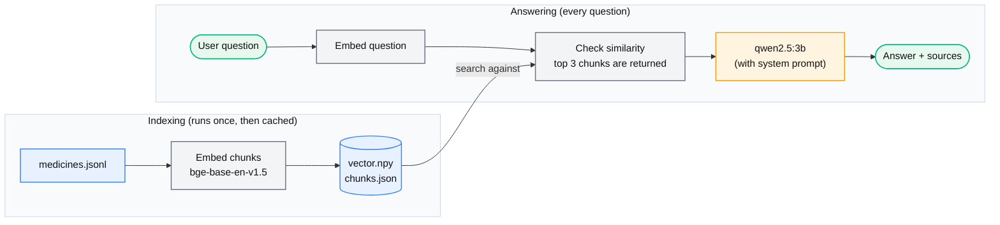

# MedRAG

A local, offline chatbot that answers questions about medicines using only the text in its own dataset. It is a small retrieval-augmented generation (RAG) system.

> This project is for learning. It gives general information from drug labels and is not medical advice. Always talk to a doctor or pharmacist.

## Why I built this

I started this project because I wanted to understand how RAG works, and a medicine bot seemed like a good test case, since a wrong answer there actually matters.

Here is the problem I kept reading about. A language model is trained once, on data up to some date. It does not know anything newer, and it does not know what was never in its training data. Worse, when you ask it about something it doesn't know, it often answers anyway, confidently, and gets it wrong. For a medicine that is a bad habit.

RAG is the usual fix. Before the model answers, you search your own documents for the passages most relevant to the question and hand them to the model as context. The model then answers from those passages instead of from memory. The search is done by meaning rather than by keywords, which is where embeddings and a vector database come in.

MedRAG is my small version of that idea.

## How it works


The pipeline has two phases.

**Indexing (runs once, then is cached)**

1. **Load.** `medicines.jsonl` is read line by line. Each line holds one text chunk.
2. **Embed.** Chunks are sent to the embedding model in batches of 128.
3. **Normalize.** Every vector is scaled to length 1. After that, cosine similarity is applied.
4. **Save.** Vectors go to `vector.npy` and the chunk text to `chunks.json`. On the next start the program loads these files and skips embedding.

**Answering (runs for every question)**

1. **Embed the question** with the same model and normalize it.
2. **Search.** One matrix multiplication (`MATRIX @ q_vec`) scores the question against every chunk.
3. **Pick the top 3 chunks.**
4. **Build the prompt.** The model gets strict rules (use only the context, name the medicine, keep it short, and if the context has no answer, reply with a fixed "I don't have information about that" sentence) followed by the three chunks and the question.
5. **Generate.** `qwen2.5:3b` answers.
6. **Show the evidence.** The disclaimer is printed, followed by the sources: which chunks were used and their similarity scores.

## The data

`medicines.jsonl` has 776 chunks covering 290 medicines, from prescription drugs like sertraline and metformin to over-the-counter products like ibuprofen, loratadine and minoxidil. Each line looks like this:

```json
{"chunk": "MINOXIDIL - Indications: Use to regrow hair on the top of the scalp (vertex only, see pictures on side of carton)"}
```


## Tech stack

- Python 3.14.7
- [Ollama](https://ollama.com) to run both models locally
- Embeddings: `hf.co/CompendiumLabs/bge-base-en-v1.5-gguf`
- Language model: `qwen2.5:3b`
- NumPy for vector storage and similarity search


## Getting started

### Prerequisites

- Python 3.9 or newer
- [Ollama](https://ollama.com/download) installed and running
- Around 2 to 3 GB of free disk space for the two models

### Install

```bash
git clone https://github.com/ryecabbage/MedRAG.git
cd MedRAG

pip install -r requirements.txt

ollama pull hf.co/CompendiumLabs/bge-base-en-v1.5-gguf
ollama pull qwen2.5:3b
```

### Run

```bash
python main.py
```

The first run embeds all the chunks and writes `vector.npy` and `chunks.json`, which takes a little while. Later runs load them straight from disk. When you see `Index is ready~`, type a question. Type `quit` to exit.

### Rebuilding the index

If you edit `medicines.jsonl` or switch the embedding model, delete the cache so it gets rebuilt:

```bash
rm vector.npy chunks.json
python main.py
```

The cache is not invalidated automatically yet, so skipping this step means you will be searching the old data.

### Examples

Question: How often does the minoxidil label say to apply it?</br>
Answer: Directions • apply one mL with dropper 2 times a day directly onto the scalp in the hair loss area. This is general information, not medical advice. Please consult a doctor or pharmacist. Sources: - MINOXIDIL - Dosage - score : 0.79 - WITCH HAZEL - Dosage - score : 0.72 - SALICYLIC ACID GEL (also called SALICYLIC ACID) - Dosage - score : 0.71


Question:What is doxylamine succinate used for?</br>
Answer: DOXYLAMINE SUCCINATE is used to help reduce difficulty in falling asleep. This is general information, not medical advice. Please consult a doctor or pharmacist. Sources: - DOXYLAMINE SUCCINATE - Indications - score : 0.85 - DOXYLAMINE SUCCINATE - Warnings - score : 0.77 - DOXYLAMINE SUCCINATE - Dosage - score : 0.74 


Question: What are the side effects of lamotrigine?</br>
Answer: I don't have information about that in my knowledge base. This is general information, not medical advice. Please consult a doctor or pharmacist. Sources: - CLONIDINE HYDROCHLORIDE - Warnings - score : 0.65 - LAMOTRIGINE - Indications - score : 0.64 - LAMOTRIGINE - Dosage - score 0.64 


## Configuration

These constants are at the top of `main.py`:

| Setting | Default | What it does |
|---|---|---|
| `EMBEDDING_MODEL` | `hf.co/CompendiumLabs/bge-base-en-v1.5-gguf` | Model that turns text into vectors |
| `LANGUAGE_MODEL` | `qwen2.5:3b` | Model that writes the final answer |
| `TOP_N` | `3` | How many chunks are sent to the model |
| `BATCH_SIZE` | `128` | Chunks embedded per request while indexing |
| `VECTORS_FILE` / `CHUNKS_FILE` | `vector.npy` / `chunks.json` | Cache files |


## Limitations
- **No conversation memory.** Each question stands alone. "What are its side effects?" will not know which medicine you mean.
- **Small models make mistakes.** Even with strict rules, a 3B model can occasionally drift away from the context.
- **Not a medical tool.** It does not know your history, and it should never be used to decide a dose or a treatment.

## Ideas for next steps

- Relevance threshold, picked from the score gap in the test set
- A safety check before the model runs, so questions about overdose, pregnancy or dosing for children get a fixed "see a doctor or pharmacist" reply
- A check that a medicine named in the question actually exists in the data
- Rebuild the cache automatically when `medicines.jsonl` changes
- Chat memory for follow-up questions

## Project structure

```
MedRAG/
├── main.py         
├── medicines.jsonl   
├── requirements.txt
├── vector.npy             
└── chunks.json
```


## Disclaimer

MedRAG provides general information drawn from drug label text. It is not a substitute for professional medical advice, diagnosis or treatment. In an emergency, contact your local emergency number or poison control center.
